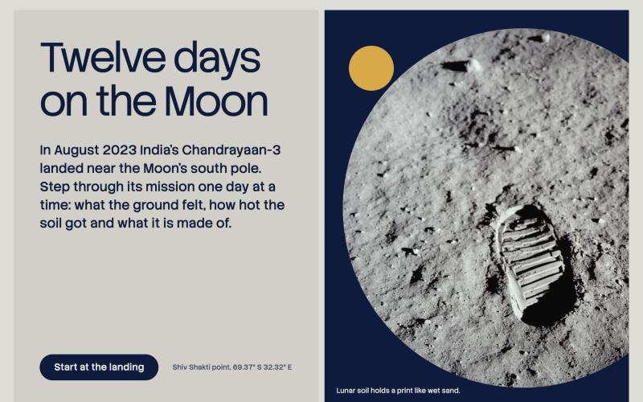
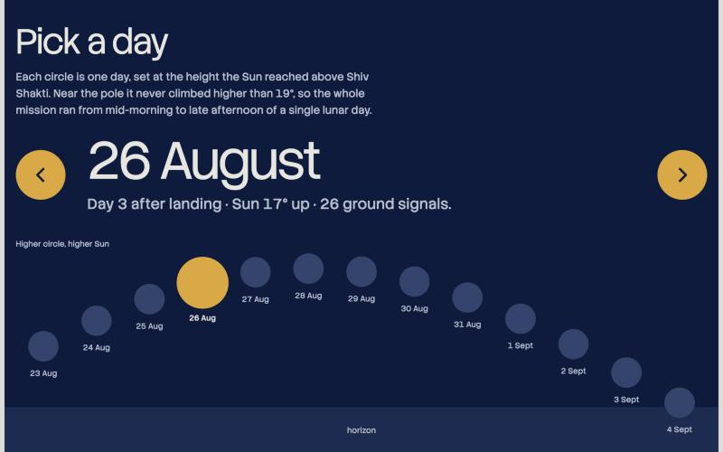
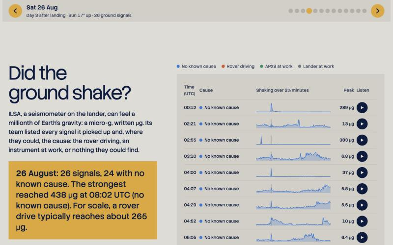
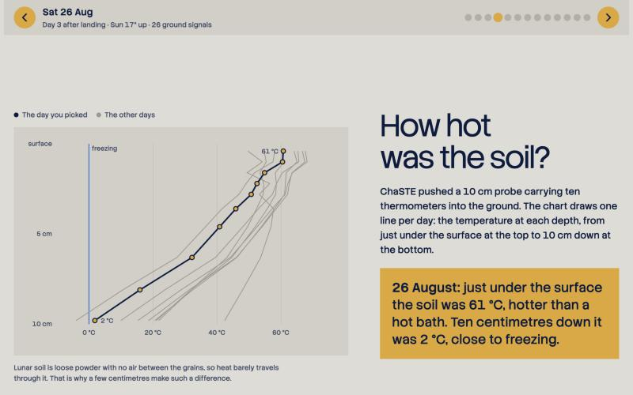
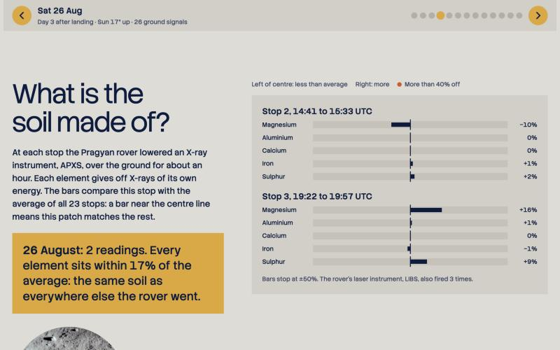
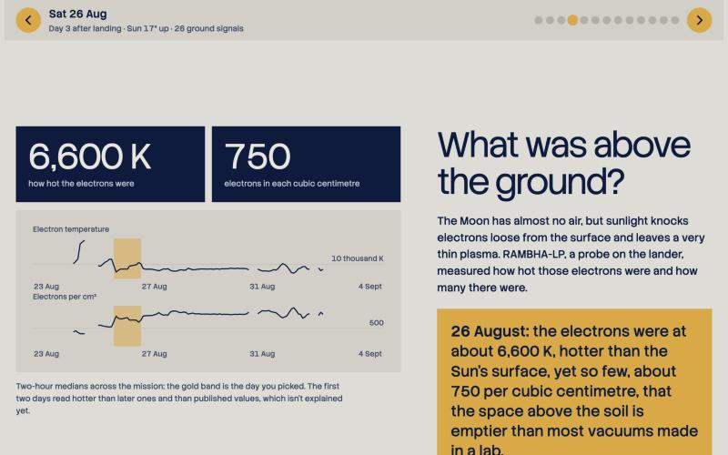
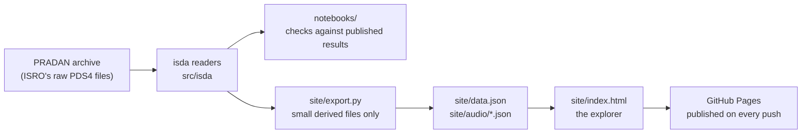

# Chandrayaan3-days

Chandrayaan-3's twelve days on the Moon, rebuilt from ISRO's own raw data.

**[Open the explorer →](https://madhavsomanath.github.io/Chandrayaan3-days/)**



## Why this exists

On 23 August 2023, Chandrayaan-3 landed near the Moon's south pole. For the next twelve days the Vikram lander and the Pragyan rover measured the ground under them: how it shook, how hot it was, what it's made of, and the thin plasma above it.

Most of us saw that mission through press releases and a handful of plots. The actual measurements are public, on ISRO's [PRADAN](https://pradan.issdc.gov.in/) archive, but they come as PDS4 files that you can't open without specialist tools and a fair bit of patience. I wanted to see what the instruments really recorded, day by day, and make that readable for people who'll never download a 16 GB seismometer archive.

So this project is two things:

- **A website anyone can read.** Pick a day of the mission and see, in plain language, what each instrument found that day.
- **A Python package, `isda`,** that reads the five surface instruments' files into tidy tables, for anyone who'd rather dig into the data themselves.

Every number on the site is computed here from ISRO's files, not copied from a paper. To keep myself honest, two notebooks check the package against results ISRO and its scientists have published, including the places where my numbers don't quite match.

## What the explorer shows

### Pick a day

Each dot on the arc is one day, placed at the height the Sun actually reached above the landing site. Near the pole the Sun never got higher than 19°, so the whole mission happened between a lunar mid-morning and late afternoon. That detail surprised me, and it's why the picker is drawn as the Sun's path rather than a plain list of dates. Tap or drag along the arc, use the arrow buttons or your keyboard, or swipe on a phone. Everything below updates to that day, and each day has its own link (for example `#aug30`).



### Four questions, answered for the day you pick

Each section asks one simple question, says in a sentence how the instrument answers it, and sums up the chosen day in the gold box.

<table>
  <tr>
    <td width="50%"></td>
    <td width="50%"></td>
  </tr>
  <tr>
    <td><b>Did the ground shake?</b><br>Every signal the ILSA seismometer recorded that day, with its cause where the team could find one (rover driving, an instrument at work, or unknown). Press play to hear the shaking, sped up so your ears can pick it up.</td>
    <td><b>How hot was the soil?</b><br>ChaSTE's ten thermometers on a 10 cm probe. The chosen day is drawn over all the others: about 60 °C just under the surface, close to freezing 10 cm down.</td>
  </tr>
  <tr>
    <td></td>
    <td></td>
  </tr>
  <tr>
    <td><b>What is the soil made of?</b><br>At each stop the rover's APXS measured magnesium, aluminium, calcium, iron and sulphur. Bars show how each stop differs from the average of all 23; most sit close to the centre line.</td>
    <td><b>What was above the ground?</b><br>RAMBHA-LP measured the very thin plasma over the surface: electrons hotter than the Sun's surface, but only hundreds per cubic centimetre.</td>
  </tr>
</table>

Further down, the page sums up the mission in four parts and three numbers, and is upfront about what the data can't tell us yet. It works on phones, tablets and desktops, and most of the fiddly design work went into making the phone version feel right.

## How it fits together



| Folder | What's in it |
|---|---|
| `src/isda/` | The package. `pds4.py` reads any PDS4 product from its label; `ch3.py` has one reader per Chandrayaan-3 instrument |
| `tests/` | Tests for the readers, run against real archive files |
| `notebooks/` | Two notebooks that reproduce published Chandrayaan-3 results |
| `site/` | The explorer: `index.html`, the data it loads, the pictures, and `export.py`, which builds the data |
| `.github/workflows/pages.yml` | Publishes `site/` to GitHub Pages whenever `main` changes |
| `docs/screenshots/` | The pictures in this README |

The raw data never goes into the repository: ISRO's rules don't allow re-hosting it. It stays in `data/`, which git ignores.

## Setup

You need Python 3.10 or newer, and a free PRADAN account for the data.

### 1. Install

```bash
git clone https://github.com/MadhavSomanath/Chandrayaan3-days.git
cd Chandrayaan3-days
python3 -m venv .venv && .venv/bin/pip install -e '.[test]'
```

### 2. Download the data

Sign in at [PRADAN](https://pradan.issdc.gov.in/), open Chandrayaan-3, and download the surface instruments ("Bulk Download" avoids the ZIP size cap). Unzip each one into `data/raw/ch3/`:

| Instrument | What it measures | Folder | Size unpacked |
|---|---|---|---|
| ILSA | Ground shaking | `data/raw/ch3/ilsa` | ~16 GB |
| RAMBHA-LP | Plasma above the surface | `data/raw/ch3/rambha` | ~6 GB (only the `_rawB` folders are read) |
| APXS | Soil elements (rover) | `data/raw/ch3/apxs` | ~1.2 GB |
| ChaSTE | Soil temperature | `data/raw/ch3/chaste` | ~115 MB |
| LIBS | Soil elements by laser (rover) | `data/raw/ch3/libs` | ~124 MB |

The site also reads ILSA's event list, `ILSA_EventIdetification_List_Note.pdf`, from `data/raw/ch3/docs/`. It's in the ILSA documents on PRADAN.

See what you've got:

```bash
.venv/bin/isda inventory data/raw/ch3
```

### 3. Run the tests

The tests read real archive files, so they need the data from step 2.

```bash
.venv/bin/python -m pytest -q
```

### 4. Use the readers

Load any product from its label:

```python
from isda import load
objects = load("data/raw/ch3/.../some_product.xml")   # {object name: DataFrame or ndarray}
df = next(iter(objects.values()))
df.attrs["units"]          # column -> unit, from the PDS4 label
```

Or use the Chandrayaan-3 readers, which return tidy, UTC-indexed DataFrames:

```python
from isda import ch3
temps = ch3.chaste("data/raw/ch3/chaste")            # K, sensors 1..10; depths in ch3.CHASTE_DEPTH_MM
quake = ch3.ilsa("data/raw/ch3/ilsa", "2023-08-25 17:00", "2023-08-25 17:05")  # m/s^2, reads only the files needed
xray = ch3.apxs("data/raw/ch3/apxs/apx/data/obs29_mob45_20230902")             # counts vs energy (keV)
spectra, shots = ch3.libs("data/raw/ch3/libs/lib-v2/data/calibrated/20230831/<product>/<product>.xml")  # counts vs nm
sweeps = ch3.rambha("data/raw/ch3/rambha", "2023-08-29 00:10", "2023-08-29 01:10")  # I-V sweeps, 0.1 V steps
plasma = ch3.langmuir(sweeps)   # per sweep: floating/plasma potential (V), Te (eV, K), Ne (m^-3)
```

### 5. Run the notebooks

```bash
.venv/bin/pip install -e '.[notebooks]'
cd notebooks && ../.venv/bin/jupyter nbconvert --to notebook --execute --inplace 01_chaste_temperature_profile.ipynb
```

### 6. Rebuild and run the explorer locally

```bash
.venv/bin/python site/export.py                        # ~10 min; writes site/data.json and site/audio/<day>.json
.venv/bin/python -m http.server 8765 --directory site  # then open http://localhost:8765
```

`export.py` writes only derived values (hourly means, event peaks, element ratios, short normalised waveforms), never raw products. The site already includes these files, so you only need this step if you change how they're computed.

### 7. Publish your own copy

Fork the repository, then in its **Settings → Pages** set **Source** to **GitHub Actions**. The workflow in `.github/workflows/pages.yml` publishes `site/` on every push to `main`. `index.html` has no `<!doctype>`/`<html>` wrapper because it's also published as a claude.ai artifact; the workflow adds one.

### 8. Optional: the "Ask the mission" chatbot

The explorer has a chatbot that answers questions using only this project's own data, and cites where each answer comes from. If the answer isn't in the data, it says so instead of guessing. It runs on a small Cloudflare Worker, so the Claude API key never touches the page. [chat/README.md](chat/README.md) covers running it locally and putting it online.

## Results

| Notebook | Reproduces | Result |
|---|---|---|
| `01_chaste_temperature_profile` | ISRO's first temperature-vs-depth plot (27 Aug 2023) | 68 °C at 4 mm (ISRO: ~70 °C). Coldest is −5.6 °C at 98 mm, not ISRO's −10 °C at 80 mm. Gradient 3.9–6.8 °C/cm through 25–31 Aug |
| `02_rover_soil_chemistry` | Vadawale et al. 2024 (*Nature*), Sinha et al. 2025, ISRO's LIBS release (29 Aug 2023) | All 23 APXS soil stops, element ratios within ~1–14 % of each other, sulphur at every stop. LIBS shows Mg (strongest line), O, Al and Si; sulphur doesn't show in a traverse-wide stack |

The temperature result was the most fun to chase: the surface number lands close to ISRO's, but the coldest point sits deeper and warmer than their early plot showed.

`ch3.langmuir()` follows the RAMBHA-LP user manual's method. Treat it as a first pass, not a finished analysis. Over the whole mission (6,533 sweeps, 85 s), the daily median electron temperature is 5,300–7,500 K from 26 Aug on, inside the published 3,000–8,000 K ([Manju et al. 2025, MNRAS](https://doi.org/10.1093/mnras/staf1276)). The daily median density is 3.8–9.7×10⁸ m⁻³, against their 3.8–6×10⁸, so it runs up to ~1.6× high. Likely causes: the fit windows, and ISRO's per-day shift of the zero crossing, which this code doesn't apply. 24–25 Aug (just after probe deployment) give 11,000–18,000 K and need a closer look. Channel 1 at 20 MΩ is excluded: it disagrees with the other four settings by ~4×.

The day picker places each day at the Sun's height from a fit to the LIBS operations table (local noon 28 Aug 2023 12:58 UTC, peak 19.4°, accurate to about 0.05°).

## Known archive issues

I ran into these while writing the readers. None of them is a big deal on its own, but each one cost an evening, so they're listed here to save the next person the trouble. They're worth reporting to ISSDC (issdc@istrac.gov.in).

- **ChaSTE `ch3_cht_cal_20230828T11`**: rows aren't padded to the fixed width the label declares, and the file has 3,248 records against the label's 3,337. `ch3.chaste()` reads it as plain CSV and warns.
- **ChaSTE calibration**: `ch3_cht_res_temp_cal_coe.xml` points to `ch3_cht_res_temp_cal_coe.csv`, but the file shipped as `ch3_cht_temp_cal_coe.csv`.
- **RAMBHA-LP `nrB` dump 20230831T004808416**: both labels name the `nrA` files. `load()` falls back to the file named like the label and warns.
- **ChaSTE `re-insertion_temperature.xml`**: the label gives the unit as K, but the values are °C (0–37).
- **LIBS wavelengths run long**: in the calibrated products, lines sit ~1.6 nm high in the ultraviolet (Si 251.6, Mg 280.3) and ~0.8 nm high at O 777.2. The user manual's detector-temperature correction isn't applied.
- **ILSA gaps aren't documented**: e.g. no data 18:16–19:31 UTC on 25 Aug 2023 (raw or calibrated), though the event list has rover motion at 18:58. Every `miscellaneous/missing_data_regions` file is empty. Use `isda inventory` start/stop times to see real coverage.

## Data rules

From the PRADAN Chandrayaan-3 disclaimer:

- The data is free for **non-profit scientific use**; ISRO keeps ownership and copyright.
- **Do not copy, lease or loan the raw data** without ISRO/DOS permission. This repo never commits or re-hosts raw files.
- **No commercial use**, including selling data derived from it.
- Any print of the data carries **"© reserved ISRO"**.

Every notebook, figure and page that uses an instrument's data carries that instrument's acknowledgement:

- **ILSA:** We acknowledge the instrument development team - ILSA, Laboratory for Electro-Optics Systems (LEOS), ISRO, Bengaluru. In addition, we acknowledge Chandrayaan-3 Project, Mission, Indian Space Science Data Centre (ISSDC) for data handling, Storage and Archival.
- **ChaSTE:** We acknowledge the use of data from the Chandrayaan-3, of Indian Space Research Organisation (ISRO), available at the PRADAN Portal, Indian Space Science Data Centre (ISSDC). ChaSTE Payload is jointly developed by Space Physics Laboratory (SPL), Vikram Sarabhai Space Centre (VSSC), Thiruvananthapuram and Physical Research Laboratory (PRL), Ahmedabad.
- **RAMBHA-LP:** We acknowledge the use of data or results from RAMBHA-LP on Indian Space Research Organization's Chandrayaan-3 lander, which is the first ever lunar landing mission close to the South pole. The above data is archived at the Indian Space Science Data Centre (ISSDC). The lead entity for the development of the RAMBHA-LP payload is Space Physics Laboratory (SPL), Vikram Sarabhai Space Centre (VSSC), Thiruvananthapuram.
- **APXS:** We acknowledge the use of data from the APXS instrument on the rover of the Chandrayaan-3 mission of the Indian Space Research Organisation (ISRO), archived at the Indian Space Science Data Centre (ISSDC). APXS experiment is designed and developed by the Physical Research Laboratory (PRL), Ahmedabad with support from Space Applications Center (SAC), Ahmedabad and U.R Rao Satellite Center (URSC), Bangalore.
- **LIBS:** We acknowledge the use of the data recorded by the LIBS instrument aboard the ISRO Pragyan rover, Chandrayaan-3 mission, archived at the Indian Space Science Data Centre (ISSDC). The LIBS instrument is developed at the Laboratory for Electro-Optics Systems (LEOS), Bengaluru with support from U.R.Rao Satellite Centre (URSC), Bengaluru.

## Picture credits

The explorer and the screenshots above use these pictures, all via Wikimedia Commons: [Vikram model](https://commons.wikimedia.org/w/index.php?curid=178618837) by Aliva Sahoo (CC BY 4.0); [landing site from orbit](https://commons.wikimedia.org/wiki/File:NASA%E2%80%99s_LRO_imagery_of_Chandrayaan-3_Landing_Site_(marked).png), NASA GSFC / Arizona State University; [Apollo 11 bootprint](https://commons.wikimedia.org/wiki/File:Apollo_11_bootprint.jpg), NASA; [Apollo 16 instruments](https://commons.wikimedia.org/wiki/File:AS16-113-18379_(21463258210).jpg), NASA / Project Apollo Archive.

## License

The code is released under the [MIT License](LICENSE). The Chandrayaan-3 data and the values derived from it belong to ISRO and follow the [data rules](#data-rules) above. The pictures keep their own licences, listed under [Picture credits](#picture-credits).
